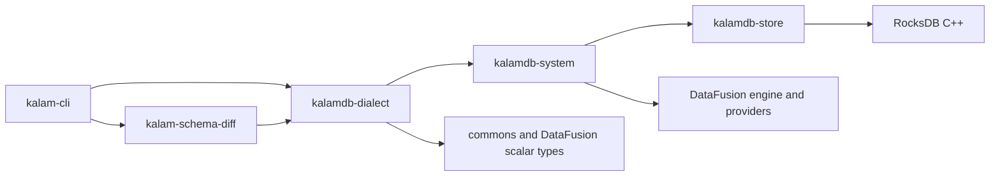

# Compilation and CI audit — 2026-10-25

This document records the pre-change baseline. The implemented dependency and CI
boundaries are described in [the architecture note](../../architecture/build-dependency-boundaries.md).

There are substantial, concrete opportunities to reduce compilation time. The highest-value work is fixing CI cache reuse, removing the CLI parser's dependency on the storage/catalog implementation, building compatible targets together, and reducing repeated test linking. A broad rewrite or removal of database functionality is not the first step.

This is an audit, not an implemented optimization. No Rust sources, manifests, workflows, or existing lockfiles were changed. The numbers below are observed CI durations or explicitly labeled graph calculations; no speedup percentage has been measured.

## Evidence and scope

- Checkout: `2101950e09daabb80aad95c222211c05a056d4c2`. The existing uncommitted lockfile changes were preserved and included in local graph resolution. Consequently, these graphs are not an exact reconstruction of earlier CI commits.
- Cargo/rustc: `1.99.1`. Package graphs target `x86_64-unknown-linux-gnu`; graph resolution ran on an Apple Silicon host.
- [Complete workspace map](dependency-map.md): all 62 workspace packages, direct internal dependencies, integration-test targets, reverse dependency reach, and duplicate versions.
- [Machine-readable dependency map](dependency-map.json): 966 cataloged packages (926 in the workspace-default resolution); workspace manifest dependency declarations, aliases, requested/default features, optionality and target predicates; global resolved edges; and five independently selected package graphs with enabled features. Includes the lockfile SHA-256.
- [CI evidence](ci-evidence.json): three recent main CI jobs, the latest available cluster job, step durations, and selected timestamped log evidence. These are failed runs, not healthy full-suite benchmarks.
- [Unit-plan evidence](unit-plan-evidence.json): local compiler-plan comparison and the shared bindgen feature mismatch; no compilation was performed for this comparison.
- Normal/build dependencies are included in server/CLI graphs; dev dependencies are included in CLI E2E and CI graphs. The production scenario explicitly enables `embedded-ui,mimalloc,traceability,cloud-aws`, not `otel` or every possible feature. Platform-specific SDK targets and all-feature combinations are not exhaustively simulated.

Package counts include the root(s), not just dependencies. They do not equal compiler invocations: Cargo may compile one package in several feature, target, or profile contexts. Package-level graphs merge those contexts; they must not be used as timing graphs.

| Selected graph | Packages | Workspace packages | Edges |
|---|---:|---:|---:|
| Default server | 620 | 45 | 2,620 |
| Server with production feature set above | 645 | 45 | 2,725 |
| CLI binary | 503 | 17 | 1,756 |
| CLI E2E, including dev dependencies | 524 | 18 | 1,833 |
| Current CI workspace selection, including dev dependencies | 736 | 56 | 3,157 |

## Measured CI baseline

All durations are seconds. Cargo's reported durations are rounded by Cargo; GitHub step/job durations use its timestamps.

| Main CI run | Job total | CLI build step | TypeScript SDK step | Nextest step, compile + run | Cargo test compilation | Test execution |
|---|---:|---:|---:|---:|---:|---:|
| [40219152857](https://github.com/kalamdb/KalamDB/actions/runs/40219152857), `444c994d3` | 2,932 | 727 | 87 | 1,903 | 1,644 | 243.957, partial |
| [40214424430](https://github.com/kalamdb/KalamDB/actions/runs/40214424430), `f4e8bf757` | 3,294 | 957 | 99 | 2,109 | failed during linking | not reached |
| [40209243939](https://github.com/kalamdb/KalamDB/actions/runs/40209243939), `b5352cee2` | 3,570 | 971 | 101 | 2,333 | 2,074 | 243.735, partial |

The most recent completed sample spent about **81% of its job duration in the explicit CLI build plus test compilation**: `(727 + 1644) / 2932`. Optimizing test concurrency alone will not address that cost. Its runner reported 5,512 tests across 191 binaries, but only 556 tests ran before failure: 552 passed and four failed. Repeated fresh-server startup failures and retries account for that sample's approximately 244-second execution phase. It is not a measurement of the complete healthy test suite. The checkout under audit contains subsequent startup/fail-fast changes, so these failures must not be attributed to the current HEAD without rerunning it.

All three runs reported **“No cache found.”** Their cache-save post-step was skipped after failure. The middle run hit linker `Bus error` failures. The evidence does not establish the resource cause of those linker failures.

The latest available [CLI Cluster E2E run, 38174736898](https://github.com/kalamdb/KalamDB/actions/runs/38174736898), is older: October 11, commit `1a28a6d3`. Its cluster workflow step took **1,224 seconds**, including **859 seconds** for the CLI dev build and **353 seconds** for test compilation. It then ran only 13 of 650 tests in **0.218 seconds**, with five failures. It downloaded the released server rather than building that server. It still compiled RocksDB through the CLI's dependencies. This older run supports the compilation diagnosis, but is not a current healthy cluster-runtime baseline. Unlike main CI, its cache-save step ran successfully after failure, taking **30 seconds**.

## Priority 1: repair cache reuse and eliminate repeated native compilation

### Save dependencies even when tests fail

In `.github/workflows/ci.yml`, `Swatinem/rust-cache@v2` uses `shared-key: ci-test-suite` without `cache-on-failure: true`. Logs confirm `CACHE_ON_FAILURE: false`; failures later in the job prevent saving the expensive completed dependency build. That creates repeated cold builds while diagnosing an unrelated test failure.

Add `cache-on-failure: true`, as the cluster workflow already does. Prefer a build job that completes and saves its cache independently of the test-execution jobs. Verify a subsequent run actually restores the cache and reuses artifacts. The action normally caches dependency artifacts and removes workspace artifacts; a dependency cache is not a substitute for distributing already-built test binaries. See [rust-cache configuration and behavior](https://github.com/Swatinem/rust-cache).

### Replace the permanent RocksDB purge with a versioned cache

The main workflow restores the cache and then unconditionally deletes RocksDB build outputs, fingerprints, libraries, and incremental directories. This was introduced to invalidate stale objects after changing the C++ optimization policy. Keeping it indefinitely prevents RocksDB cache reuse even after that migration is complete.

Use a new cache generation plus a key component for `scripts/ci-rocksdb-cxx.sh`, and remove the unconditional purge after verifying fresh artifacts. Keep the intended RocksDB `-O3` compilation policy; do not revert it just to reduce compilation time. Validate startup, storage operations, and native compiler flags before accepting the new cache generation. Include toolchain, target, profile/features and relevant native compiler inputs in cache compatibility decisions.

### Build CLI and workspace test artifacts in one feature context

Run 40219152857 compiled `librocksdb-sys` during the CLI build and again during nextest preparation. Its own features are the same, but its **build dependencies** change:

- CLI-only build: `bindgen 0.72.1` has `runtime`.
- Workspace build: V8 enables `bindgen` defaults, adding `default,logging,prettyplease` alongside `runtime`.
- Other shared build-dependency feature sets also expand, including `libc`, `proc-macro2`, and regex components.

This is a real feature-context mismatch, not proof that `dev` and `test` profiles inherently require two copies. A local Cargo unit-plan comparison, with CI profile overrides, confirmed those build-dependency differences. A combined `cargo build --profile test --bins --tests` with the same workspace selection contains every non-doctest unit in the equivalent `cargo test --no-run` plan, including the normal `kalam` binary. The local plans had 1,121 combined units; the other plan additionally had 31 doctest units. Planning did not execute compilation and is not a Linux timing measurement.

Replace the isolated CLI build with coordinated artifact preparation, preserving the requirement that the CLI exists before E2E execution. Keep package selection, features, toolchain, target, profile overrides and rustflags consistent between build and run stages. Nextest can [archive and reuse built tests](https://nexte.st/docs/ci-features/archiving/); include the normal server/CLI executables and required fixtures explicitly when distributing an archive. Do not assume an archive contains every external file a subprocess test uses.

## Priority 2: remove the parser-to-storage dependency

The CLI's dependency graph contains the entire DataFusion engine and RocksDB through one misplaced architectural boundary:



Only five dialect source files reference `kalamdb_system`:

| Source | Required item | Proposed ownership |
|---|---|---|
| `parser/system.rs` | `SystemTable` | Import from commons: system already re-exports it from there. |
| `ddl/user_commands.rs` | `StorageMode` | Move the shared model below catalog/provider implementation; re-export for compatibility. |
| `ddl/storage_commands.rs` | `StorageType` | Same shared-model treatment. |
| `ddl/alter_table.rs` | `VectorMetric` | Move/share the model without pulling providers into the parser. |
| `ddl/create_schedule.rs` | `next_schedule_run` | Extract pure scheduling validation/calculation into a dependency-light module or crate used by both parser and scheduler. |

These references are small, but their transitive cost is large. Removing only the `dialect → system` edge in a reachability calculation eliminates **75 packages** from the current CLI graph, including RocksDB and the full DataFusion execution/planning stack, leaving **428**. This is a structural estimate, not a compiling patch or a 15% timing promise: shared scheduling dependencies must be retained, and re-resolving features can change the result. Arrow and `datafusion-common` remain because the dialect directly uses their types.

Preserve one `KalamParser`/`KalamDbDialect` and one AST contract. Do not introduce a second CLI SQL parser or textual SQL rewrites. Re-export moved models to reduce churn. Validate parser/DDL/schema-diff behavior and CLI lifecycle tests. Add a dependency boundary check asserting CLI normal/build graphs contain neither RocksDB nor the full `datafusion` crate.

For the server itself, RocksDB and DataFusion remain necessary. The win is a narrower rebuild graph: the dialect can compile without waiting for the system/store chain, and CLI-only work stops rebuilding the database internals.

## Priority 3: reduce repeated test linking

Cargo metadata exposes **55 integration targets in `kalamdb-core`**, plus 11 in `kalamdb-pg` and 10 in `kalamdb-dialect`. Each integration target is a separately linked executable. CI's actual 191-binary count shows that executable fan-out is material. The CLI E2E tests already use the desired general pattern: one `tests/e2e.rs` entry point with modules.

Consolidate related core integration files into a small number of domain suites, for example transactions, query semantics, persistence, and live queries. Use explicit test targets and disable unwanted autodiscovery. Share common helpers once per suite. Retain all assertions, feature requirements, isolation, timeout and nextest grouping semantics. Nextest still runs individual tests as processes; fewer executables need not mean serialized test execution.

Measure link time, peak memory, output size and total compilation before/after. Preserve a test inventory and account for renamed test paths in filters and scripts. Do not consolidate every test in the workspace into one giant executable: it can become a new link and incremental-build bottleneck. The 55-target core crate is the first bounded experiment.

## Feature and duplicate-dependency findings

Several useful optimizations are already present. Default server features are empty; embedded UI, allocator replacement, AWS storage, OpenTelemetry and Docker-based OIDC test dependencies are absent from the default server graph. DataFusion defaults are disabled with an explicit feature subset. RocksDB defaults are disabled and only the requested native capabilities are enabled. Development Rust code is unoptimized, incremental builds are enabled locally, and main CI already disables debug information.

Remaining candidates, in lower priority order:

1. **Two object-store versions.** DataFusion uses `object_store 0.13.2`; filestore directly uses `0.14.2`. Assess whether filestore can use DataFusion's version without losing required APIs. This may simplify type conversions and remove duplicated code. With `cloud-aws`, the newer path also adds `reqwest 0.13.5` alongside `0.12.28`. Confirm API and cloud-storage compatibility before changing versions.
2. **Both TLS crypto providers.** Rustls enables both `ring` and `aws_lc_rs`. Reqwest enables ring; shared client, gRPC and PG paths enable AWS-LC, which JWT also uses separately. Investigate consistent provider selection using compatible upstream features and explicit initialization. Verify HTTP, WebSocket, OIDC, PG TLS, JWT and gRPC behavior; do not weaken crypto choices to chase compile time. Removing one rustls feature alone does not prove the corresponding library disappears from every dependency path.
3. **Actix defaults and duplicate compression.** Default `actix-web` brings Brotli/gzip/zstd, cookies, macros, Unicode and other capabilities. The graph contains Brotli 9 through Actix and Brotli 8 through Parquet. Audit actual middleware/cookie use before disabling features. Some compression cost remains needed for stored data and interoperability.
4. **Parquet/Arrow feature unification.** Even though workspace declarations disable defaults, the selected graph has Parquet defaults and Arrow CSV/JSON/prettyprint enabled through upstream dependencies. `cargo tree -e features -i parquet` identifies DataFusion/DataFusion-common re-enabling Parquet defaults. Editing only the local workspace feature list will not remove these features. Preserve existing file-codec readability; use upstream-compatible changes if justified.
5. **V8 and vector search are unconditional.** `kalamdb-functions` always depends on V8, and the vector path always depends on usearch/NumKong. An optional development build without these subsystems could help narrow work, but needs explicit unsupported-capability behavior and full-feature CI coverage. Do not silently remove procedures or vectors from the default product. V8 can use downloaded native archives, so its presence alone does not establish native compilation duration.
6. **Shared-crate coupling.** In the server graph, observability has 40 internal reverse-reachable dependents, commons 39, and configs 34. These are rebuild-exposure counts, not timings. Keep frequently changing implementation details out of shared type crates; narrow `commons/full` requests where possible. Avoid creating many tiny crates without critical-path evidence.

The complete duplicate-version inventory is in [the map](dependency-map.md). Multiple `syn`, `rand`, `http`, digest and compression versions mostly come from upstream API generations. Do not force incompatible major versions together or spend the first optimization pass removing tiny duplicate crates.

## CI execution and local workflow improvements

- **Separate compile and test timings.** Upload Cargo `--timings` HTML, JUnit, and build-context metadata on success or failure. Existing logs establish total compilation cost, but cannot reliably attribute seconds to individual crates or linkers. A `Compiling` timestamp can refer to a build script; do not subtract adjacent log timestamps and call that crate duration. Cargo's [timing report](https://doc.rust-lang.org/cargo/reference/timings.html) provides compiler-unit and concurrency information.
- **Preflight fresh-server startup once.** Fail clearly if the server exits or cannot become healthy before dispatching hundreds of dependent tests. Keep deliberate startup/recovery tests separate. Avoid repeated full readiness timeouts and generic retries for a shared failed prerequisite. Current HEAD addresses a startup issue seen in the sampled runs; validate that fix before setting a healthy runtime baseline.
- **Build once, then shard execution where justified.** Give each shard isolated state/ports; distribute a nextest archive and required binaries. Do not create several jobs that each cold-build the engine. Keep stateful and performance tests isolated. In the cluster script, `cargo nextest run -p kalam-cli-e2e` currently uses the default profile (15 threads and three retries), whereas main CI uses four threads and one retry. Make the cluster CI profile explicit and measure healthy runs before tuning concurrency.
- **Avoid broad disk cleanup unless needed.** Main CI spent 99–177 seconds freeing disk in the samples. Check the free-space budget after reducing test artifacts; make cleanup conditional. Do not remove the protection before peak disk usage is measured.
- **Treat SDK/template work separately.** The TypeScript build step cost 87–101 seconds, much smaller than Rust compilation. Run it once, cache appropriate npm/WASM inputs and preserve template coverage in its own lane. Do not drop those tests just to make the main number smaller.
- **Local flags need correction.** `.cargo/config.toml` sets unstable `-Z threads=8` while `rust-toolchain.toml` selects stable 1.99.1. A plain Cargo metadata/tree invocation failed on that flag. This audit used `CARGO_ENCODED_RUSTFLAGS=''` for graph commands. Remove the unsupported default or keep it in an explicit experimental toolchain workflow. Switching rustflags also invalidates artifacts, so benchmark with a stable flag configuration. Eight rustc threads is not an established speedup here.
- **Keep dev/test builds for development.** Use `cargo check -p kalamdb-server` for feedback that does not require an executable; use a targeted dev build when running it. Check-only results do not measure native/link costs of a real server build. Do not use release/full-LTO builds as a compilation-time workaround. Current [profile settings](https://doc.rust-lang.org/cargo/reference/profiles.html) already distinguish those purposes.

## Implementation order and acceptance gates

| Order | Change | Acceptance evidence |
|---|---|---|
| 1 | Save cache on failure; replace RocksDB purge with versioned cache; publish timings | Two consecutive comparable CI runs: cache restored, native artifacts reused, startup/storage smoke passes. |
| 2 | Coordinated CLI/server/test artifact build | Required binaries exist before E2E; compatible build units reused; no second RocksDB build; same test inventory. |
| 3 | Extract dialect's shared models/scheduling dependency | CLI graph has no RocksDB/full DataFusion engine; parser/schema/CLI tests pass; cold CLI runtime reported in seconds. |
| 4 | Consolidate the core integration test targets | Same tests/features/isolation; fewer linked binaries; measured compilation/link/disk improvement. |
| 5 | Align object-store and audit TLS/HTTP features | Targeted runtime compatibility tests; smaller resolved graph; measured cold and incremental improvement. |
| 6 | Optional subsystem builds, linker or compiler-cache experiments | Explicit feature contract and full-product lane retained; measurements show gains after the above fixes. |

Record cold server build, warm no-change build, a narrow source edit, a shared-type edit, test compilation, complete healthy test execution, cache transfer, peak memory and peak target size separately. Run at least three comparable trials per important scenario and report individual runtimes plus the median. Use isolated target directories for cold trials; preserve the developer's existing cache. Keep CPU allocation, toolchain, target, lockfile, features, profiles and compiler flags fixed. All normal build/test trials stay on development/test profiles.

Expected direction: substantial CLI and repeated-CI savings are well supported by the graph and observed duplicate work. The magnitude of standalone database cold-build savings, and whether end-to-end CI improves by 2× or more, remains unmeasured. The audit establishes what to change and how to prove it; it does not claim an achieved speedup.

## Reproducing the graph evidence

Run from the repository root. These commands resolve/read dependencies without changing the lockfile; they may download missing registry packages. Empty encoded rustflags avoid the current unsupported `-Z` setting while inspecting graphs.

```bash
CARGO_ENCODED_RUSTFLAGS='' cargo metadata --locked --format-version 1 > metadata.json
CARGO_ENCODED_RUSTFLAGS='' cargo metadata --locked --features kalamdb-server/embedded-ui,kalamdb-server/mimalloc,kalamdb-server/traceability,kalamdb-server/cloud-aws --format-version 1 > metadata-production.json
CARGO_ENCODED_RUSTFLAGS='' cargo tree --locked -p kalamdb-server --target x86_64-unknown-linux-gnu -e normal,build --prefix depth --format '{p}|{f}'
CARGO_ENCODED_RUSTFLAGS='' cargo tree --locked -p kalamdb-server --features embedded-ui,mimalloc,traceability,cloud-aws --target x86_64-unknown-linux-gnu -e normal,build --prefix depth --format '{p}|{f}'
CARGO_ENCODED_RUSTFLAGS='' cargo tree --locked -p kalam-cli --target x86_64-unknown-linux-gnu -e normal,build --prefix depth --format '{p}|{f}'
CARGO_ENCODED_RUSTFLAGS='' cargo tree --locked -p kalam-cli-e2e --target x86_64-unknown-linux-gnu -e normal,build,dev --prefix depth --format '{p}|{f}'
CARGO_ENCODED_RUSTFLAGS='' cargo tree --locked --workspace --exclude kalam-pg-extension --exclude kalam-link-wasm --exclude kalam-consumer-wasm --exclude kalam-link-dart --exclude kalamdb-python --exclude quickstart --target x86_64-unknown-linux-gnu -e normal,build,dev --prefix depth --format '{p}|{f}'
CARGO_ENCODED_RUSTFLAGS='' cargo tree --locked -p kalam-cli --target x86_64-unknown-linux-gnu -e normal,build -i rocksdb
```

The JSON normalizes package identity to `name@version` after checking it is unique in this snapshot. Workspace paths are repository-relative. `workspace_default_resolution` is the broad Cargo metadata result, while `scenarios` contains the selected target graphs. The hypothetical edge cut is explicitly marked as structural only.
