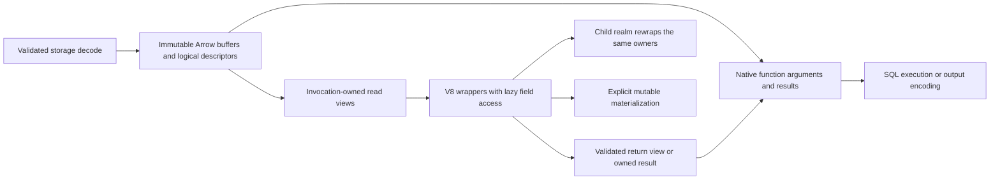

# Contract: Shared Values, Function Calls, and V8

**Requested extension**: 2026-10-11. Align query/storage values, SQL routines, JS/TS arguments/results, nested calls and host operations with G3's logical types and byte budgets. This is implementation planning; no copy elimination or runtime speedup has been measured yet. #393 owns type/ABI integration, #394 execution semantics, #397 evidence; coordinate with #383 without declaring that issue complete.

## Decision and boundaries

Reuse immutable Arrow owners across native boundaries and pass host-backed read views into V8. Materialize only accessed fields or explicitly requested mutable objects. Move eligible exclusive buffers into/out of V8 instead of cloning them. Ordinary JS objects, strings needing transcoding, wire output and durable writes still have real conversion costs. “Zero-copy” means no payload-byte copy at a named eligible boundary; wrappers, reference counts, scalar loads and validation still cost CPU/memory.

SQL and PL/pgSQL routines use their native runtime/execution contract, not V8. JavaScript and TypeScript remain Kalam extensions. This work does not add a serializer or a second logical type registry, and does not require a v2 disk-format switch before native call improvements can land.



Storage-to-Arrow primitive materialization remains as described in [row-storage.md](row-storage.md). The reuse target begins with the validated owner. Projection, permissions, snapshot visibility and descriptor resolution must already be correct before values enter an invocation.

## Current-code evidence

At `be5efdd2`, Cargo.lock resolves `v8` 152.2.0:

- `core/src/functions/convert.rs::scalar_struct_from_row` extracts each Arrow cell as a ScalarValue and converts it back to a one-element array; `execution_result_to_rows`/`rows_to_routine` then rebuild row lists. Preserve the existing direct ScalarRows fast path where it is cheaper.
- `functions/src/abi/convert.rs` converts structs/lists again field by field, copies binary via `bytes.to_vec()` into a V8 backing store, and copies returned Uint8Array contents. Strings use V8 string construction. JSON takes a distinct parse/stringify path; ordinary typed values already avoid JSON.
- `core/src/functions/executor.rs::pack_named_call_input` converts named parameters into JSON; key probes can parse values repeatedly. Typed named calls must not acquire a JSON detour or substitute failed conversions with NULL.
- `functions/src/v8/async_ops.rs` infers guest arguments into scalars, clones the parameter vector for nested-call preparation, and executes the child in a separate context. Preserve its immutable permission-frame semantics.
- `RoutineValue.transfer` is optional encoded data that the current V8 converter does not consume. Caching an encoded value is not evidence of zero-copy invocation.
- The current ABI lowers micro/nanosecond timestamps to milliseconds and has permissive numeric casts. G3 precision/range tests must include this boundary, not stop at SQL/wire metadata.
- Existing `EngineConfig`, `ConversionBudget`, `BufferAllocator` and admission logic are the owners to extend. Imported backing stores and pinned Arrow buffers need explicit coverage beyond V8 heap and allocator limits.

These are inspected mechanisms, not measured percentages or claims about every call path.

## One transport model, derived from the logical type

Evolve `RoutineValue` in place into a typed transport envelope with mutually exclusive payload forms. Proposed forms are compact owned scalar/literal, Arrow cell or slice reference, projected batch/row view, and exclusive transfer buffer. A cell is an `ArrayRef` plus checked index/range, not a newly allocated one-element array. A row view retains a batch owner plus row index and authorized projection. Existing stored row schemas and Arrow descriptors remain derived from `LogicalTypeRef`.

Resolve an immutable call descriptor once per routine/schema/type revision: logical argument/result types, named argument ordinals, nullability, conversion policy, ABI version, and relevant security dependencies. Keep each model in its own file. Functions consumes these descriptors injected by core; it must not depend on core or resolve the type registry per row/field.

Do not simultaneously retain a scalar tree, JSON tree and encoded transfer for the same value. Remove `type_id`/`json_sql`/transfer fields as independent authorities when the canonical descriptor/payload replaces them. A small scalar convenience form is a physical representation, not a competing type definition.

Borrowed views are valid within a synchronous scope only. Anything crossing await, worker queues or retained JS wrappers carries owning Arc/Buffer references and a budget lease. No pointer to a temporary `RowView`, iterator value, stack slice or released RecordBatch may escape. The owner also pins the needed descriptor revision, but does not hold a RocksDB iterator, lock or transaction snapshot open solely to keep an already materialized value alive.

## Copy and ownership matrix

| Boundary | Required path | Copy rule |
| --- | --- | --- |
| RecordBatch → native argument/result | Retain ArrayRef/batch owner with descriptor and indices | No payload copy for representation-compatible values; scalar loads/coercions accounted separately |
| Native result → V8 read view | Wrapper holds a checked native handle | No eager traversal or cloning of unused fields |
| Read view → nested function → returned view | Validate signature/provenance, rewrap in child's realm | Reuse owners if compatible; do not serialize through JSON/ScalarValue trees |
| Read view → normal JS object/array | Direct bounded Arrow-to-V8 materialization | One conversion; remove intermediate row/scalar reconstruction |
| Immutable shared bytes → mutable Uint8Array | Private invocation-owned bytes | One copy unless exclusive ownership can be proved and transferred |
| Exclusive owned bytes → V8 backing store | Move into supported backing-store API | No payload clone when allocator/build constraints permit; otherwise one explicit copy |
| JS Uint8Array → native immutable value | Explicit transfer with validated offset/length and detachment, or snapshot copy | Never borrow bytes that JS can still mutate |
| UTF-8 → JS string | Convert on access; optional eligible external string | No blanket zero-copy string promise; account transcoding and retention |
| JSON/JSONB → JS object | Canonical typed conversion on demand | Parsing/object creation cost remains; SQL JSON null and SQL NULL stay distinct |
| Return to HTTP/PG wire or durable storage | Existing canonical codecs | Output encoding/write costs are outside the no-copy forwarding claim |

No implicit ownership transfer from caller-owned JavaScript buffers. Transfer is explicit in the versioned ABI/API because detachment changes observable behavior. SharedArrayBuffer, resizable/growable buffers, live aliasing, unsupported alignment, or unresolved ownership use a safe copy or explicit rejection under that ABI. Never disable sandboxing to gain a fast path.

The fetched rusty_v8 docs identify 152.2.0, matching Cargo.lock: owned-buffer constructors take ownership, detachment invalidates JS views, and sandbox builds impose address-space restrictions. Validate actual build features/allocator behavior before enabling these paths. [rusty_v8 ArrayBuffer](https://docs.rs/v8/latest/v8/struct.ArrayBuffer.html). V8 backing stores expose mutable cells; retaining a reference does not establish immutability. [rusty_v8 BackingStore](https://docs.rs/v8/latest/v8/struct.BackingStore.html).

A buffer slice is not automatically transferable: a guest can inspect an ArrayBuffer's full contents through another view. Expose only authorized bytes, including through `.buffer`; compact a subrange when its owner includes other rows, columns, padding or tenants. A reference count of one on an outer wrapper alone does not prove no inner buffer aliases exist. Validate alignment/endianness/offsets before typed views; no unsafe Vec reconstruction from memory with a different allocator.

## JS-visible API and compatibility

Keep current ABI v2 `ctx.db.query` array/object behavior, cardinality, mutation and enumeration semantics unless a documented ABI migration changes them. Its implementation can materialize directly from Arrow and avoid the intermediate scalar trees. Do not silently replace mutable plain objects with proxies or readonly objects.

Introduce explicit read-view access in the next ABI revision, with generated TypeScript declarations. Proposed names below are a design contract to validate in T113, not APIs that exist today:

```typescript
// Proposed next-ABI API: shared native owners, materialization only on access.
const rows = await ctx.db.queryView("SELECT id, payload FROM app.events WHERE id = $1", [id]);
const row = rows.at(0);                    // undefined if no row; no row-value clone
const result = await ctx.functions.call("app.inspect_event", [row]);
// The function boundary validates types and rewraps the same native owner.
const editable = row.materialize();       // explicit detached plain JS object copy
```

`queryView` is bounded and rejects oversized results; it never silently truncates. `rows.at()` checks range; row fields expose authorized names through schema-backed accessors. Define field access, enumeration, iteration, nested views, missing property/NULL handling and JSON.stringify in generated docs and tests. Materializing or serializing intentionally reads/converts values. Property getters read already-owned data only; they must not synchronously fetch storage, execute SQL or acquire a transaction lock. Treat names such as `__proto__`, `constructor` and numeric-looking keys as data with specified enumeration behavior, not prototype mutation. Cache accessed field wrappers only within a bounded invocation policy; repeated access must not reconvert an entire object.

Add `ctx.db.queryBatches` as a bounded async iterator over read-only batch views, with a cancellation-safe `return`/close path; no collect-all list behind its streaming name. Reading the next chunk honors backpressure. A suspended cursor must not hold the host-operation serialization mutex while waiting for guest code. Define safe same-transaction interleaving with nested SQL: resume/suspend against the correct snapshot where supported, or reject the conflicting operation explicitly before effects; never deadlock, silently open another transaction or unboundedly drain the stream. Wrappers can survive an await or child call while the root invocation remains active; closing an iterator stops production while already-owned views remain valid and charged. Escaped handles become invalid on root completion. Sparse retained rows use the same compaction policy as query views to avoid pinning large chunks indefinitely.

Never transparently vectorize an arbitrary scalar/volatile/side-effecting JS routine. An explicit batch routine declares its ABI and per-batch input/output contract, including row order/count, nulls and error/transaction behavior; tests prove the new semantics. Keep ordinary SQL function invocation/null/volatility rules independent of this optimization.

## Lifetimes, permissions and concurrency

A read view is unforgeable native state with generation, root invocation identity, descriptor and owner. Validate it at use, not by trusting a guest property containing an integer/pointer. Detect forged, stale and wrong-generation handles without dereferencing freed memory. Accessors run in the creating realm's immutable host frame. They must never consult a mutable “current caller” slot for authorization.

Nested calls retain the current separate child realm. Recreate data-only wrappers in that realm; never forward parent ctx objects, native callbacks, arbitrary prototypes, accessors or raw JS objects as a permission shortcut. Explicitly passed data has already been disclosed to the caller; it conveys no authority to issue SQL or access omitted fields. SECURITY INVOKER/DEFINER, root HTTP capabilities, RLS and the common transaction/deadline remain enforced.

V8 Local/Global handles are used on their owning isolate worker and appropriate scopes; they never travel through a Send host future or another isolate. Async work passes native owned data only and re-enters V8 on completion. V8 handles are not interchangeable with raw object addresses during GC. [V8 embedding and handles](https://v8.dev/docs/embed).

Ordinary JS-origin object arguments are snapshotted/validated before async work under existing semantics; proxies/getters may have effects, so do not treat them as immutable database views. Directly forwarded host views skip value traversal only when descriptor equality/constraints make it safe. Mutated/materialized objects follow normal validated conversion, including overflow, domain and nullability checks. Returning a compatible host view reuses its native payload; returning transformed guest values builds a fresh validated result once. No return path implicitly persists guest mutations.

Before successful root completion, transfer ownership and its memory charge for authorized native return values to the receiving execution/output scope, then invalidate guest handles. At completion/error/cancel/timeout, stop new operations, drain/cancel host work according to transaction rules, invalidate handles, drop strong roots and release invocation leases. GC finalizers are a safety net, not the only bound on memory. If guest globals or external resources still pin bytes, keep them charged until actual disposal or retire/dispose the isolate within the global budget. Context reset alone is not proof that backing memory was freed. Release each resource exactly once on all paths, without invoking V8 from a foreign-thread deleter.

## Type fidelity at the V8 boundary

- Int64/UInt64 round trips must not depend on lossy Number conversion. Adopt a stable generated mapping (e.g. BigInt in the new ABI) with explicit legacy behavior; reject out-of-range/nonintegral values instead of truncating or defaulting to zero.
- Numeric uses a lossless decimal representation or typed wrapper, including negative scale and special values; it never round-trips through binary float as an optimization.
- Timestamp/timestamptz retain microsecond precision, range/infinities and zone semantics. A millisecond JS Date is not the canonical transport. Choose a generated typed value or precise representation in T113.
- JSON number/BigInt behavior, JSON null versus SQL NULL, undefined/missing properties, invalid UTF-8/unpaired JS surrogates, NaN/infinity and cyclic guest graphs require explicit supported mappings/errors.
- Arrays retain dimensions/lower bounds and element/composite nulls; enums retain stable IDs/order in native form. The same descriptor controls function arguments, returned values, catalogs, DataFusion, storage and wire codecs.

External strings are an optional measured optimization for already compatible immutable character data: ASCII UTF-8 is eligible for one-byte representation, general UTF-8 is not Latin-1; UTF-16 requires suitable owned storage. Keep the owner alive until disposal and compact small slices where retention dominates. Do not allocate a second transcoded cache without counting it. [V8 external strings](https://v8.github.io/api/head/classv8_1_1String.html).

## Unified memory accounting and performance

Extend existing engine budgets to cover managed heap, V8-owned/imported backing stores, host Arrow owners, wrappers/handles, compiled artifacts, conversion scratch, pending inputs/results and stream prefetch. Charge before admitting/allocating. Account unique owner capacities rather than adding logical slice lengths; per-invocation quotas still apply when ownership is shared. Owner transfers move charges atomically and must not create a budget gap or double release. V8 external-memory notifications help GC but are not a hard admission limit. Imported buffers cannot bypass `BufferAllocator`/`EngineConfig` limits.

Use the existing per-worker isolate pool and compiled-script cache. Cache conversion descriptors and property templates by ABI/routine/type revision, with byte limits; V8 handles/templates stay isolate-local. Preserve realm reset and schema/routine invalidation. Measure cold load, warm invocation, queueing, conversion, host wait, JS CPU and GC independently before changing pooling policy.

T112 extends existing `functions/benches/v8_runtime.rs` plus `benchv2/pg18/` with: primitive call; large bytea echo; ASCII/non-ASCII text; numeric/temporal/JSON/array round trips; wide-row sparse/full field access; query → child call → return; mutation/materialization; streamed batches; many concurrent invocations; and cancellation while buffers/results are pinned. Include sizes around inline/large-value limits and repeated nested forwarding. Report runtimes in seconds, p50/p95/p99, CPU, allocation count/bytes, bytes copied by boundary, peak/retained native and V8 memory, owner lifetimes, GC and throughput.

Acceptance extends [execution-performance.md](execution-performance.md):

1. Compatible native forwarding and host-view child forwarding copy **zero payload bytes**, backed by owner-identity/copy-counter tests, not merely latency. Additional forwards scale in handles/arguments, not payload size; initial decode/materialization is measured separately.
2. Eligible exclusive buffer transfer performs no payload clone; fallback copies are labelled by reason (mutability, slice exposure, allocator/sandbox, encoding). Unsupported fast paths never pretend to be zero-copy.
3. Target at least 20% fewer allocated bytes and 10% lower CPU/median runtime on query→function→nested-call workloads versus the current path, under the existing regression limits. Full-field access and small scalar calls must not be sacrificed for sparse-view wins.
4. All retained owners and external allocations remain within global/invocation limits under GC delay, slow consumers and cancellation; memory reaches a bounded steady state after cleanup. No forced GC per call to manufacture a result.
5. Type, permission, mutation and transaction tests pass before enabling new ABI features. PG comparisons cover equivalent SQL semantics; V8-specific benchmarks compare KalamDB base/candidate and do not imply PostgreSQL supports JS/TS.

## Delivery and cleanup

T112 baseline → T113 type/ABI contract → T114 native owners/direct materialization → T115 read views → T116 safe transfer/accounting and T117 nested/result forwarding → T118 precision/semantic regressions → T119 streaming/batch path → T120 lifecycle/concurrency gates → T121 generated APIs/docs → T122 integrated performance/cleanup. Tests precede each implementation; T116/T120 safety checks precede enabling borrowed/transfer paths. Implement stream safety incrementally; do not wait until final validation to design cancellation.

Delete replaced per-row scalar reconstruction, repeated JSON packing/probes and redundant transfer caches only after all consumers migrate. Existing ABI compatibility uses the same descriptors/conversion primitives, with one owner and an explicit deprecation policy. The durable KOBJ catalog codec and a genuinely required external transfer format are not removed merely because the V8 hot path stops using them.
